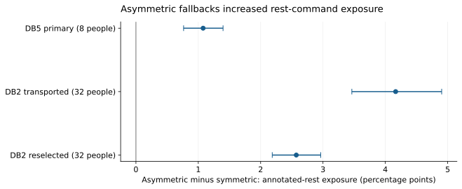
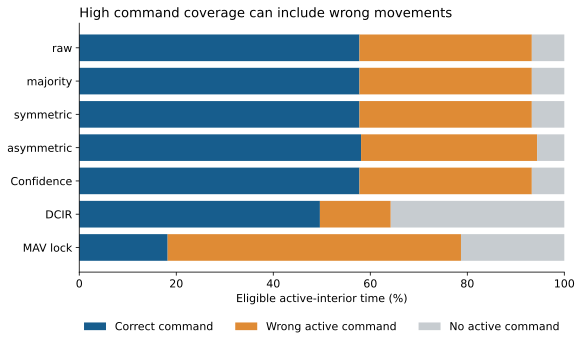

# EMG command filtering under start and stop constraints

**An offline biomedical engineering benchmark of command reliability, timing and coverage.**

Muscle signals can be decoded into movement commands, but filtering those commands trades off unwanted activation, response delay and release delay. This project tests whether separate activation/release persistence helps under explicit joint requirements.

**Result:** the tested controller grids did not meet the combined development requirements. The primary asymmetric fallback increased command exposure during annotated rest. This is a documented negative result, with reproducible code and explicit limits.

| Comparison | Final dataset participants | Change in rest exposure, percentage points | Paired bootstrap 95% interval |
|---|---:|---:|---:|
| DB5 primary: asymmetric − symmetric | 8 | +1.077 | [0.764, 1.397] |
| DB2: transported DB5 settings | 32 | +4.165 | [3.463, 4.904] |
| DB2: development-reselected settings | Same 32 | +2.572 | [2.186, 2.963] |

Positive values mean more nonzero-command time during annotated rest. These are descriptive comparisons after failed development feasibility. They do not establish improvement under the joint requirements.



## Manuscript draft

[Read the manuscript draft (PDF)](manuscript/EMG_Manuscript_Draft.pdf) · [Project in the portfolio](https://ksricharan7.github.io/portfolio/emg.html)

Author-shared draft, October 15, 2026. Not peer reviewed or journal published. The draft does not change the frozen benchmark or released results.

## Interactive replay lab

[Try the EMG replay lab](https://ksricharan7.github.io/portfolio/emg-lab.html). Edition 1 compares raw, symmetric, asymmetric and trailing-majority controllers on clearly labeled synthetic command streams. A separate fixed-results view displays the released DB5/DB2 contrasts. Sliders do not recompute the study results.

The [lab source and validation checks](https://github.com/KSRICHARAN7/portfolio/tree/main/emg) live with the portfolio. Browser controller/confirmation outputs match 160 Python reference cases; 16 scenario/controller metric sets were cross-checked against the native Python scorer.

## Exploratory missing-channel extension

[Read the extension and reproduce it](extensions/channel_dropout/README.md). With the original decoder and fixed asymmetric fallback, averaging all 16 single-channel masks reduced correct active-interior output by **6.355 percentage points** [descriptive 95% interval 5.328, 7.567]. This is a separately planned, exploratory stress test of training-mean feature imputation on already-seen DB5 recordings. It does not revise the original study or establish clinical robustness.

## What was built

- Causal trailing-window EMG features and training-only standardization.
- Personalized shrinkage LDA decoders, with raw, voting, persistence, confidence and onset-locking controller comparisons.
- Native sample-time scoring of held commands, confirmed onset/release, active coverage and correct/wrong commands.
- A frozen DB5 protocol, 23 sensitivity cases and a native-rate DB2 replication.
- Participant-level paired uncertainty estimates, aggregate tables, figures and reproducibility checks.

The contribution is the benchmark and constraint-aware evaluation. No new control algorithm is claimed.

## Start here

```bash
python3.12 -m venv .venv
source .venv/bin/activate
python -m pip install -r requirements.txt
python scripts/verify_release.py
python -m unittest discover -s tests -v
```

The 51 synthetic/unit checks and release verification run without downloading datasets. See [REPRODUCING.md](REPRODUCING.md) to acquire exact source files and regenerate final comparisons. Source data, features, fitted models and sample-level traces are not distributed here.

## Study design

DB5: development IDs1–2, final IDs3–10;16 channels at200Hz. DB2: development IDs1–8, final IDs9–40;12 channels at2000Hz. Each person trains on repetitions1/3/4; final evaluation uses2/5, with6 unused. There are34 eligible events per final person. Channels produce MAV, RMS and mean waveform-length features over150ms windows with25ms hops.

Goals are >=90% stable-correct onset by250ms, >=90% stable-rest confirmation by150ms, and >=80% nonzero active-interior coverage. Stability requires100ms; confirmation is not backdated. All14 DB5 methods had0/8 joint successes; all19 DB2 methods had0/32. Coverage includes wrong commands and is not accuracy.



## Read the evidence

- [All DB5 methods](evidence/tables/T03_DB5_all_methods.md) · [All DB2 methods](evidence/tables/T04_DB2_all_methods.md)
- [Paired comparisons](evidence/tables/T05_paired_contrasts.md) · [All sensitivity contrasts](evidence/tables/T07_all_DB5_sensitivities.md)
- [Figure captions](evidence/FIGURE_CAPTIONS.md) · [Claim boundaries](evidence/tables/T11_claim_evidence_matrix.md)
- [Frozen protocol](docs/step4_protocol/Frozen_Protocol_v1.0.md) · [Metric/statistics notes](docs/METRIC_AND_STATISTICS_NOTES.md)
- [Limitations](docs/LIMITATIONS.md) · [Contributions and AI assistance](docs/CONTRIBUTIONS.md)

The six public figures and aggregate tables are a selected release from the private evidence package. Sample-level failure illustrations and fitted artifacts are withheld. Some captions/claim-map references identify private source records; see [RELEASE_SCOPE.md](RELEASE_SCOPE.md) for their public equivalents.

## Scope and publication status

This is offline intact-limb replay, not a clinical or closed-loop prosthetic trial. Some training repetitions occur later in recording time than evaluation repetitions; retrospective labels are not measured intention. Dataset IDs do not establish independent biological cohorts. The dated freeze is internal, not public preregistration. All outcomes are already exposed.

**An author-shared manuscript draft is available above; it is not peer reviewed or journal published.** Cite the benchmark as software using CITATION.cff; no paper DOI is claimed.

[Dataset access and attribution](DATA_ACCESS.md) · [Release scope](RELEASE_SCOPE.md) · [MIT license for original code/documentation](LICENSE)
